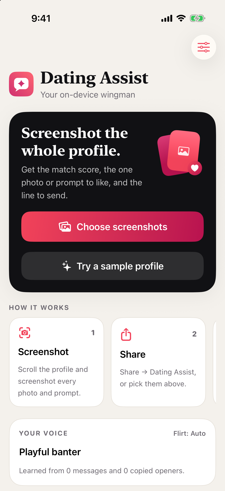
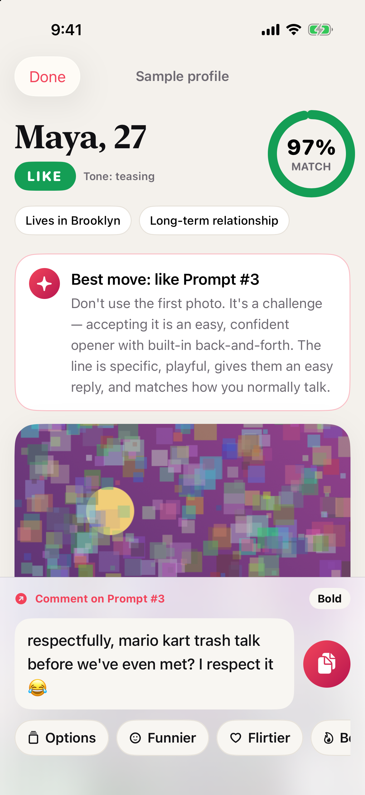
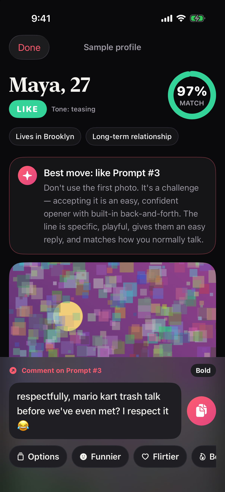
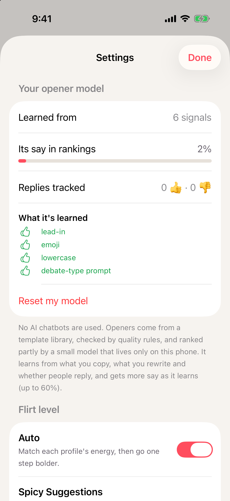

# Dating Assist (project: Hinge_assist)

<p align="center">
  
  
  
  
</p>

**SwiftUI · Vision OCR · Share Extension · on-device ML · no generative AI · 57 tests**

An iPhone dating copilot. You share screenshots of a whole dating profile. The app reads every photo and prompt, scores compatibility with your preferences, ranks every photo and prompt as a conversation starter, picks the single best one, and writes the strongest opener in your own voice.

**You stay in control.** The app never logs in, scrapes, swipes, likes or messages. It suggests; you copy, like and send.

This is a build of the *Signal — iPhone AI Dating Copilot* build document, renamed Dating Assist. It's built **without generative AI**: rules, ~400 templates, and a personal ranking model that runs on the phone.

## Run it

1. Open `Hinge_assist.xcodeproj` in Xcode 26+.
2. Run the **Hinge_assist** scheme on an iPhone simulator. No setup needed.
3. In the app, tap **Try a sample profile**. It renders a synthetic profile as screenshots and runs the full pipeline on them: OCR, rebuilding the profile, ranking, and writing openers.
4. To test with images, drag `Fixtures/SyntheticScreenshots/*.png` into the Simulator's Photos, then tap **Choose screenshots**.

**On a real iPhone:** set your Team under *Signing & Capabilities* for both targets. If you change the bundle IDs, also change the App Group (`group.com.roszhanraj.HingeAssist`) in `Config/*.entitlements` and in `CaptureInbox.appGroup`.

**Tests:** run `cd HingeAssistKit && swift test` (57 tests), or press ⌘U in Xcode.

**Debug launch arguments:**
- `-skipOnboarding`: skip onboarding.
- `-runSample`: analyze the sample profile at launch.
- `-darkSample`: use dark-mode sample screenshots.
- `-demoReplies`: add example copied openers so the "Did they reply?" card shows.
- `-openSettings`: open Settings at launch.

## No AI

Dating Assist uses **no generative AI and makes no network calls**. Everything runs on the phone:

| Step | How it works |
|---|---|
| Reading screenshots | Apple's built-in on-device text recognition and photo labels (the same kind of feature as the camera's text scanner) |
| Scoring and picking the target | Plain rules and formulas |
| Writing openers | ~400 templates in `TemplateLibrary.swift`, filled with the most specific phrase from the profile, plus variants with an optional lead-in ("okay but…") or closer ("…defend yourself") |
| Choosing the best opener | Quality rules blended with **your personal model** |

`ProviderRouter` refuses any engine that isn't on-device, so nothing can leave the phone.

### Your personal opener model

`OpenerModel` is a small logistic-regression model. It is trained on the phone, and only ranks openers; it never writes them. Each opener becomes 25 numbers (specificity, humor, flirt level, length, emoji, question, lead-in/closer, style, prompt type).

It learns from:
- **Copy:** "I like this one". The openers you passed over count as a weak "not this".
- **Rewrite buttons:** "not quite". Too much and Too safe count more than the others.
- **"Did they reply?" 👍/👎** on the home screen: the strongest signal (2× weight).

It starts neutral with no say. Its share of the ranking grows with every signal, up to 60% at 150 signals. Settings → *Your opener model* shows what it has learned and lets you reset it.

## How a profile is analyzed

```
screenshots → fix orientation & resize to 2048px → Vision OCR + photo detection + on-device photo labels
 → line up overlapping screenshots and remove duplicates → rebuild the profile (name, age, basics, prompts, photos)
 → score every photo and prompt (reply 30 / specificity 25 / humor 15 / flirt 15 / originality 10 / style 5)
 → compatibility (your 5 preferences, dealbreakers as hard rules) → pick ONE best target
 → write 12+ base candidates (3 funny, 3 flirty, 2 teasing, 2 complimentary, 2 bold) + lead-in/closer variants
 → critics: naturalness (A–E), "could this go to 20 profiles?" test, repeats-the-profile, invented facts,
   sensitive traits, flirt calibration, safety
 → rank (specificity 25 / reply 20 / naturalness 20 / flirt 15 / humor 10 / originality 10), blended with your personal model → best line + alternatives
```

**Rewrites:** More options, Too safe, Too much, Funnier, Flirtier, Bolder, More teasing, More complimenting, More mysterious, More direct, Shorter, and More suggestive (only with Spicy Suggestions on). Each one gradually updates your **Message DNA**, and so does every opener you copy. A single interaction can move a trait by at most 0.06.

## Safety and privacy

- Spicy Suggestions is off by default. It needs an 18+ confirmation, and it only applies when the other person's *own words* are suggestive. Photos never raise the flirt level.
- If anything suggests the person may be under 18, the app gives no opener, no flirting, and recommends SKIP.
- Openers never bring up race, religion, health, sexuality, body, income or politics.
- Screenshots from the Share Extension sit in a temporary App Group folder until the app opens them, then are deleted. Anything older than an hour is purged. Photos are kept in memory only for the screen you're on.
- Only your preferences, Message DNA, your model's numbers and the openers you copied are saved, as text.

## Evaluation

`EvaluationSuiteTests` runs the engine over 100 synthetic profiles. These include dealbreaker, suggestive, wholesome and sparse profiles, plus two that suggest the person may be under 18. Current results:

| Metric | Result |
|---|---|
| Invented facts | 0% |
| Safety violations | 0 |
| Same input → same ranking | 100% |
| Dealbreakers / possible minors skipped | 100% |
| Naturalness pass rate | 100% |
| Average specificity | 4.2 / 5 |
| Reply potential | 3.3 / 5 |
| Shown openers with specificity < 3 | 0 |
| Average time per profile | ~80 ms |

## Layout

```
Hinge_assist/          SwiftUI app: App, Features (Onboarding, ProfileAnalysis, Preferences, MessageStyle, Settings), Shared
HingeAssistShare/      Share Extension (saves screenshots to the App Group inbox)
HingeAssistKit/        Swift package with all the logic: Models, Text, Vision, Engine, AI, Storage, Fixtures, Evaluation + tests
Config/                Entitlements and the extension's Info.plist
Fixtures/              Synthetic screenshots (never commit real people's profiles)
```

## Not built yet

- Testing on a real iPhone. Everything has been tested in the simulator and with unit tests.
- Exporting your feedback data to train a bigger model on a Mac with Create ML (Apple's free trainer). The on-phone model covers this for now.
- The app is now called Dating Assist (the Xcode project and folders keep the original Hinge_assist name).
